<p align="center">
  
</p>

<p align="center">
  
</p>

<p align="center">
  <strong>One ship for all your plunder.</strong><br>
  A Linux game launcher for your Steam, Heroic, Lutris, Bottles and Faugus games.
</p>

<p align="center">
  <a href="https://github.com/IkrajaDev/PlunderHub/releases/latest"></a>
  
  
  
</p>

<p align="center">
  <a href="#install"><b>Install</b></a> ·
  <a href="#screenshots"><b>Screenshots</b></a> ·
  <a href="#support"><b>Support</b></a>
</p>

<p align="center">
  
</p>

---

> [!NOTE]
> PlunderHub is in beta. Please report any bugs you find.

## Screenshots

<table>
  <tr>
    <td align="center" valign="top" width="50%">
      <a href="docs/gallery/01-library-grid.md"></a><br>
      <sub>Library, grid view</sub>
    </td>
    <td align="center" valign="top" width="50%">
      <a href="docs/gallery/02-treasure-map-card.md">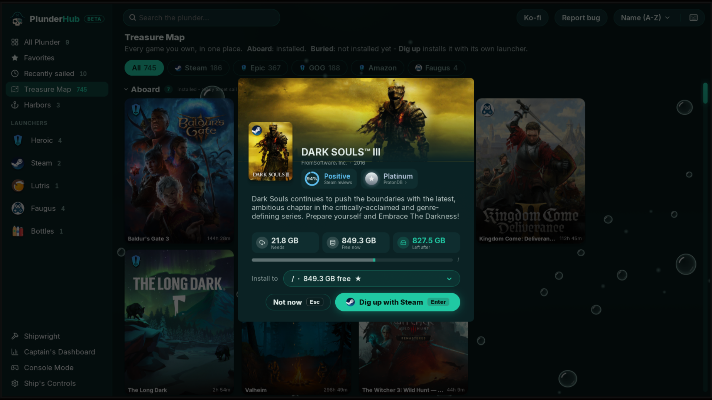</a><br>
      <sub>Treasure Map: dig up a game</sub>
    </td>
  </tr>
  <tr>
    <td align="center" valign="top" width="50%">
      <a href="docs/gallery/03-game-overview.md">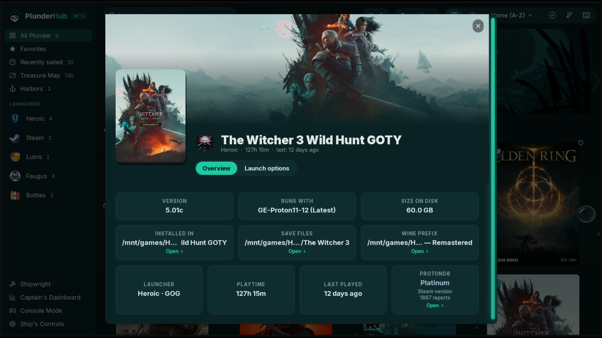</a><br>
      <sub>Game page</sub>
    </td>
    <td align="center" valign="top" width="50%">
      <a href="docs/gallery/04-console-mode.md">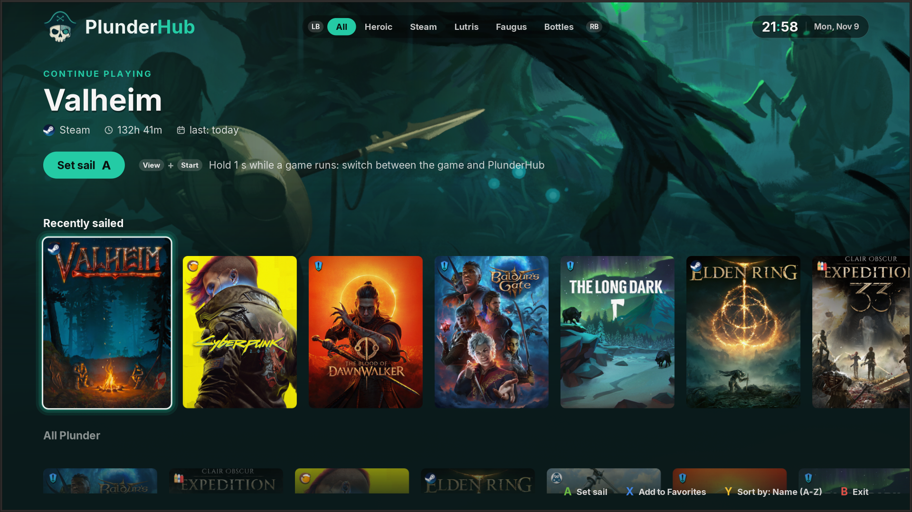</a><br>
      <sub>Console Mode</sub>
    </td>
  </tr>
</table>

<details>
  <summary>More screenshots</summary>

<table>
  <tr>
    <td align="center" valign="top" width="50%">
      <a href="docs/gallery/05-library-list.md">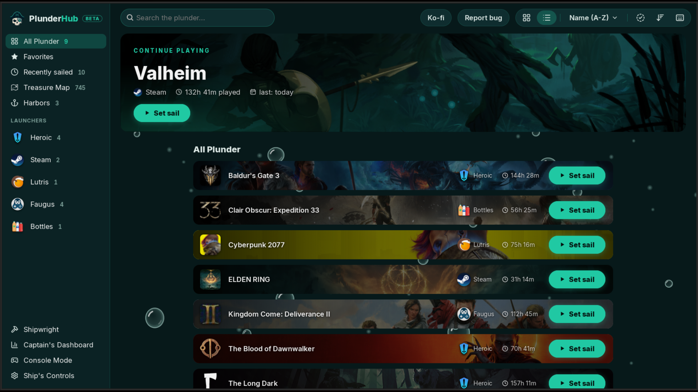</a><br>
      <sub>Library, list view</sub>
    </td>
    <td align="center" valign="top" width="50%">
      <a href="docs/gallery/06-edit-order.md">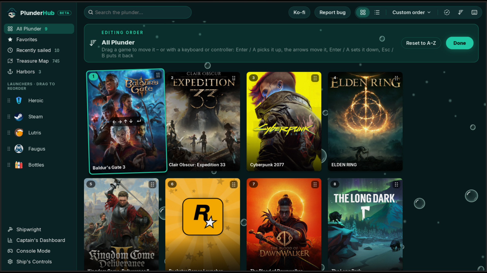</a><br>
      <sub>Edit order</sub>
    </td>
  </tr>
  <tr>
    <td align="center" valign="top" width="50%">
      <a href="docs/gallery/07-game-menu.md">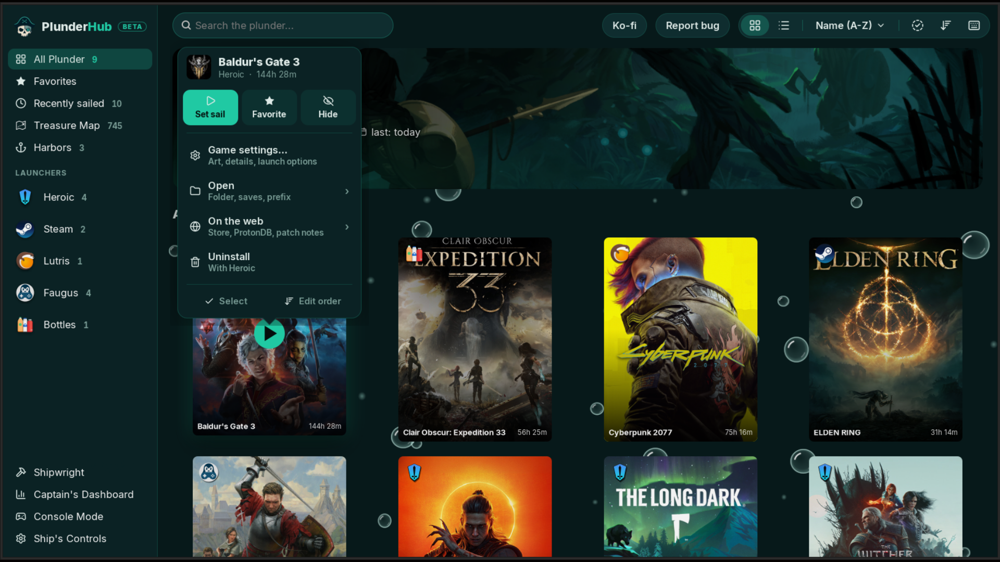</a><br>
      <sub>Set sail menu</sub>
    </td>
    <td align="center" valign="top" width="50%">
      <a href="docs/gallery/08-treasure-map.md">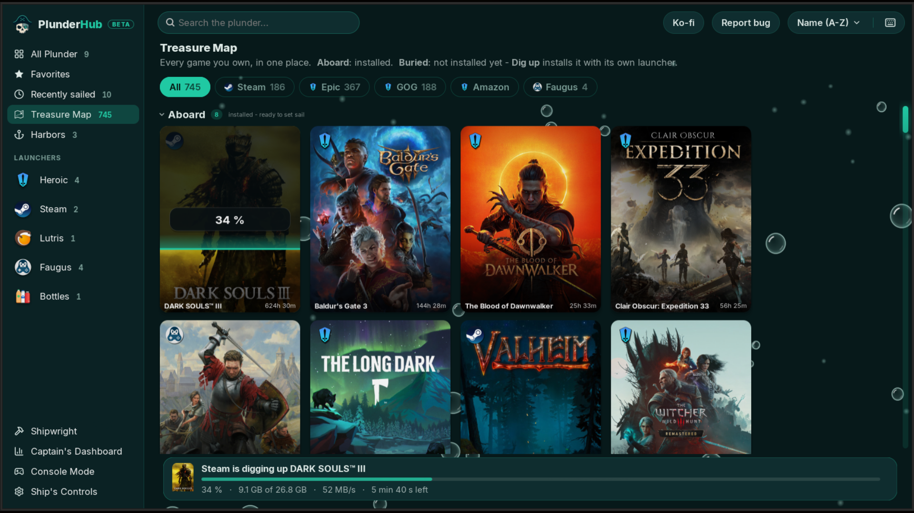</a><br>
      <sub>Treasure Map</sub>
    </td>
  </tr>
  <tr>
    <td align="center" valign="top" width="50%">
      <a href="docs/gallery/09-treasure-map-faugus.md">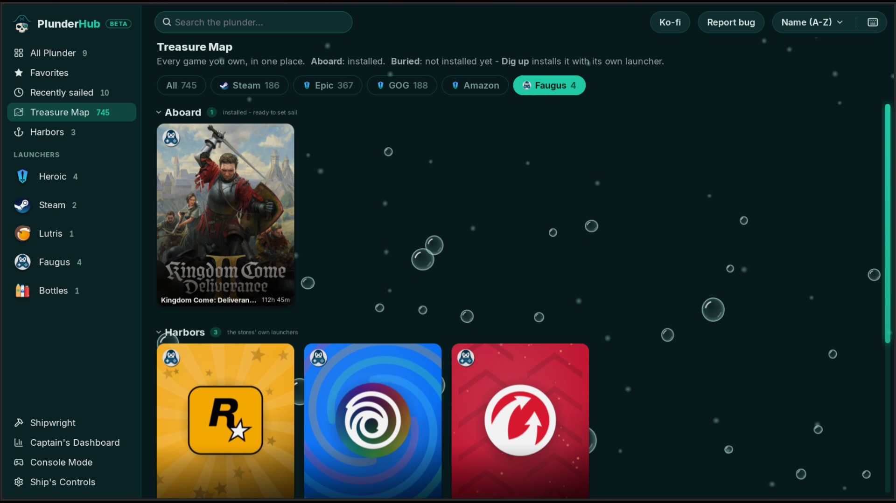</a><br>
      <sub>Treasure Map: the Faugus tab</sub>
    </td>
    <td align="center" valign="top" width="50%">
      <a href="docs/gallery/10-game-launch-options.md">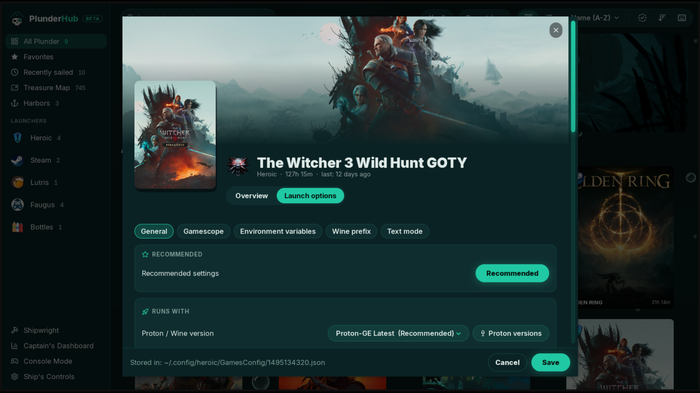</a><br>
      <sub>Launch options</sub>
    </td>
  </tr>
  <tr>
    <td align="center" valign="top" width="50%">
      <a href="docs/gallery/11-proton-versions.md">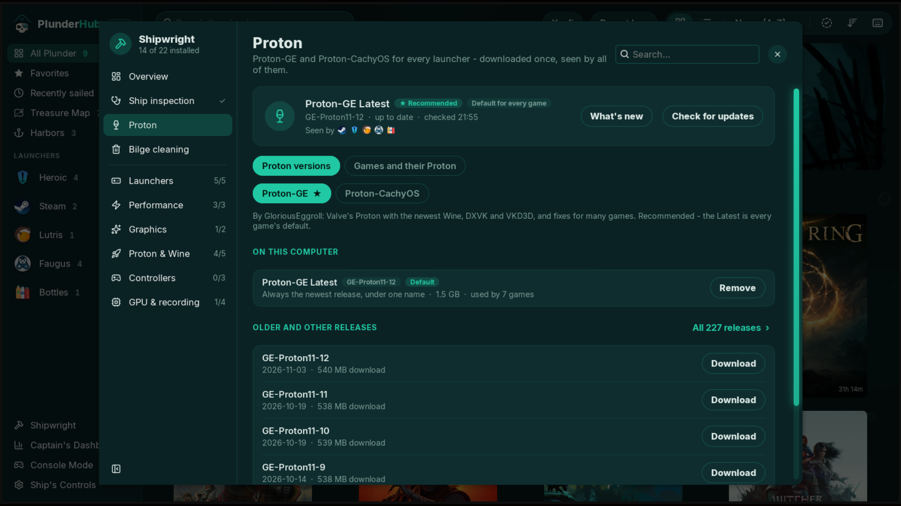</a><br>
      <sub>Proton versions</sub>
    </td>
    <td align="center" valign="top" width="50%">
      <a href="docs/gallery/12-shipwright.md">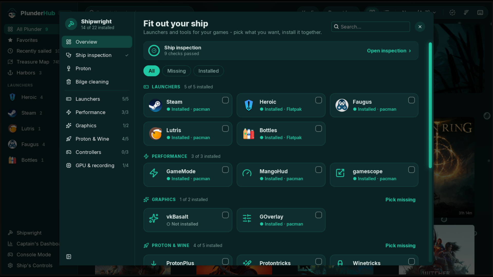</a><br>
      <sub>Shipwright</sub>
    </td>
  </tr>
  <tr>
    <td align="center" valign="top" width="50%">
      <a href="docs/gallery/13-bilge-cleaning.md">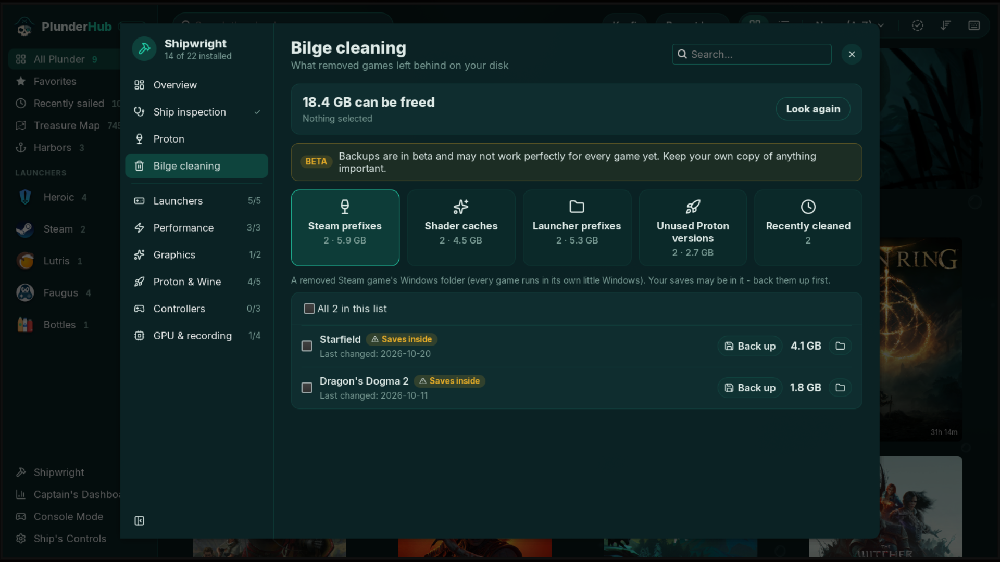</a><br>
      <sub>Bilge cleaning</sub>
    </td>
    <td align="center" valign="top" width="50%">
      <a href="docs/gallery/14-captains-dashboard.md">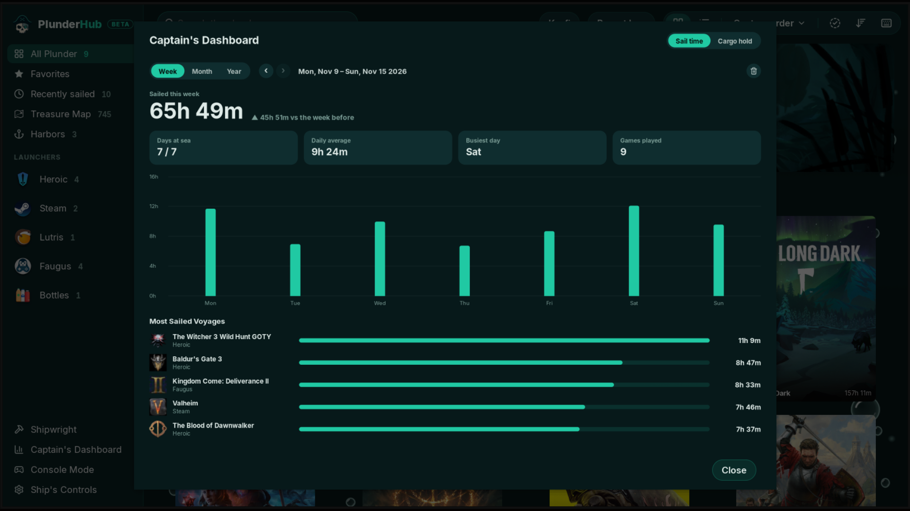</a><br>
      <sub>Captain's Dashboard</sub>
    </td>
  </tr>
  <tr>
    <td align="center" valign="top" width="50%">
      <a href="docs/gallery/15-cargo-hold.md">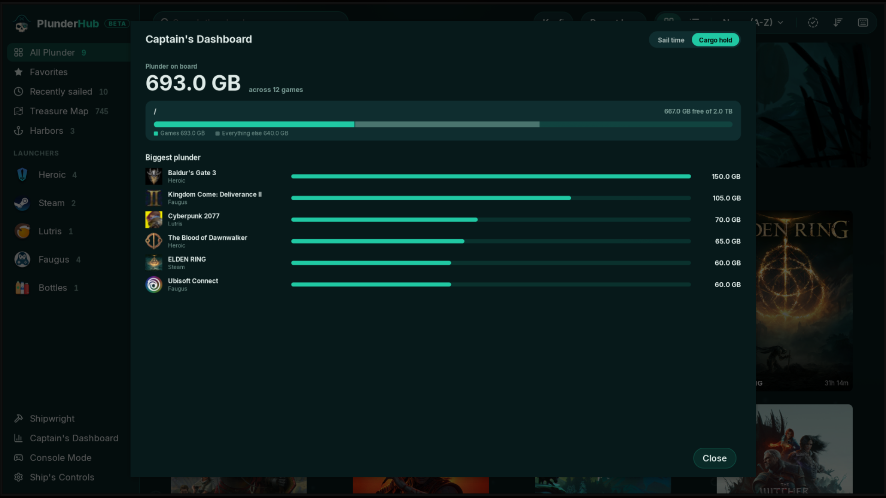</a><br>
      <sub>Cargo hold</sub>
    </td>
    <td align="center" valign="top" width="50%">
      <a href="docs/gallery/16-settings-appearance.md">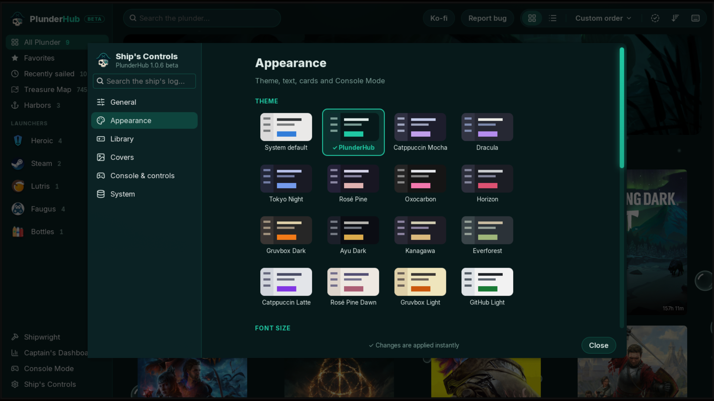</a><br>
      <sub>Ship's Controls</sub>
    </td>
  </tr>
  <tr>
    <td align="center" valign="top" width="50%">
      <a href="docs/gallery/17-themes.md">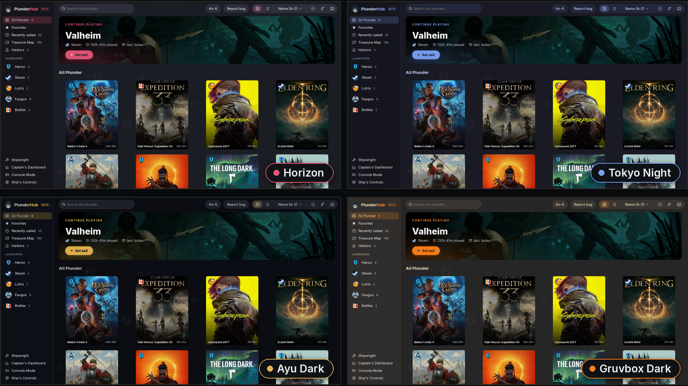</a><br>
      <sub>15 themes</sub>
    </td>
    <td align="center" valign="top" width="50%">
      <a href="docs/gallery/18-report-bug.md">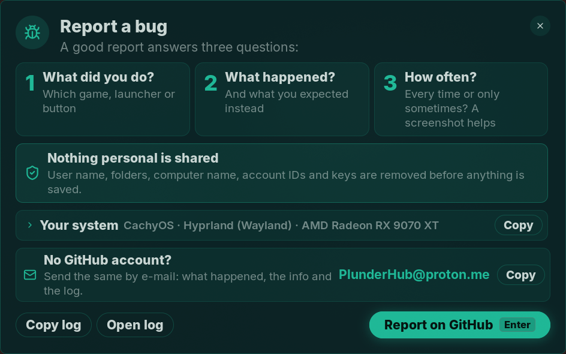</a><br>
      <sub>Report a bug</sub>
    </td>
  </tr>
</table>

</details>

## Features

<table>
  <tr>
    <td align="center" valign="top" width="25%">
      <br>
      <b>One&nbsp;library</b><br>
      <sub>All&nbsp;launchers&nbsp;together</sub>
    </td>
    <td align="center" valign="top" width="25%">
      <br>
      <b>Treasure&nbsp;Map</b><br>
      <sub>Every&nbsp;game&nbsp;you&nbsp;own</sub>
    </td>
    <td align="center" valign="top" width="25%">
      <br>
      <b>ProtonDB</b><br>
      <sub>Ratings&nbsp;on&nbsp;every&nbsp;game</sub>
    </td>
    <td align="center" valign="top" width="25%">
      <br>
      <b>Proton</b><br>
      <sub>GE&nbsp;and&nbsp;CachyOS,&nbsp;shared</sub>
    </td>
  </tr>
  <tr>
    <td align="center" valign="top" width="25%">
      <br>
      <b>Launch&nbsp;options</b><br>
      <sub>Per-game&nbsp;tweaks</sub>
    </td>
    <td align="center" valign="top" width="25%">
      <br>
      <b>Console&nbsp;Mode</b><br>
      <sub>Made&nbsp;for&nbsp;controllers</sub>
    </td>
    <td align="center" valign="top" width="25%">
      <br>
      <b>Shipwright</b><br>
      <sub>Tools&nbsp;installed&nbsp;for&nbsp;you</sub>
    </td>
    <td align="center" valign="top" width="25%">
      <br>
      <b>Ship&nbsp;inspection</b><br>
      <sub>Finds&nbsp;and&nbsp;fixes&nbsp;problems</sub>
    </td>
  </tr>
  <tr>
    <td align="center" valign="top" width="25%">
      <br>
      <b>Bilge&nbsp;cleaning</b><br>
      <sub>Free&nbsp;up&nbsp;disk&nbsp;space</sub>
    </td>
    <td align="center" valign="top" width="25%">
      <br>
      <b>Captain's&nbsp;Dashboard</b><br>
      <sub>Playtime&nbsp;and&nbsp;storage</sub>
    </td>
    <td align="center" valign="top" width="25%">
      <br>
      <b>Themes</b><br>
      <sub>15&nbsp;themes</sub>
    </td>
    <td align="center" valign="top" width="25%">
      <br>
      <b>Lightweight</b><br>
      <sub>Idles&nbsp;when&nbsp;unused</sub>
    </td>
  </tr>
</table>

<details>
  <summary>More</summary>

- **Treasure Map**: every game you own on Steam, Epic, GOG and Amazon on one page, installed or not. Install or uninstall one with a click. Right-click an installed game for the same menu as in your library.
- **Proton**: Proton-GE and Proton-CachyOS, downloaded once and used by every launcher, native or Flatpak. A new Proton-GE shows up at the bottom left and downloads when you press Download.
- **Game page**: the game's ProtonDB rating for every launcher, store, ProtonDB and patch notes links. Launch options with a Recommended preset; winecfg, winetricks and running an .exe in the game's prefix.
- **Ship inspection**: checks Vulkan drivers (AMD, NVIDIA, Intel, hybrid laptops), 32-bit libraries, the memory map limit, ntsync and fonts, and fixes them in one click.
- **Shipwright**: installs launchers (native or Flathub) and tools like GameMode, MangoHud, gamescope, controller drivers and much more.
- **Bilge cleaning**: finds what removed games left behind - Wine prefixes, shader caches, unused Proton versions - with their size. You pick what goes, to the Trash or for good. Backs up the saves in them first and can put them back later.
- **Harbors**: Battle.net, EA app, Epic, GOG Galaxy, Ubisoft Connect, Rockstar, Amazon and Wargaming get a row of their own under your games, one click (or <kbd>H</kbd>) away. In Console Mode they have their own shelf.
- **Faugus**: the Treasure Map's Faugus tab installs those store launchers, a Windows game from its installer or .exe, or a Linux game, each in its own Wine prefix. Remove any of them from its menu: the prefix goes to the Trash, is deleted for good or stays - you pick.
- **Games from store launchers** (new, please report problems): a game you install with one of those launchers gets its own card, cover and launch options, starts through its launcher, and PlunderHub counts its playtime. Launchers themselves count no playtime.
- **Live status**: see what's running, stop it anytime.
- **Art**: covers, banners and icons from your launchers, even animated. Add a free SteamGridDB key for more.
- **Saves**: Heroic cloud sync, backup and restore.
- **Steam Deck and Big Picture**: adds PlunderHub to Steam as a non-Steam game (Settings > Library).
- **Controllers**: Xbox, PlayStation, Switch Pro, 8BitDo and more, with matching button icons. Hold View + Start to switch between a game and PlunderHub.
- **Welcome tour**: a short guided tour on the first start - open it again from the logo in the sidebar.
- **Backup**: settings, playtime and art in one file.
- **Tray**: close to the tray, start hidden at login.
- **Updates**: tells you about new versions and can install them.

</details>

### Does it change my existing installs?

PlunderHub reads what your launchers already have. Browsing your library changes nothing, and you need no extra account.

- **Games you own but haven't installed:** Steam and Heroic keep a list of them on your PC. Epic, GOG and Amazon come through your Heroic sign-in.
- **A new game turns up:** PlunderHub asks whether you want the recommended launch options and Proton-GE Latest for it.
- **Launch options, installs, uninstalls and cleaning:** only when you ask.
- **Prefer it automatic?** Settings can apply the recommended options and update Proton-GE without asking. Both are off by default.

Three things happen on their own: Proton versions you've downloaded are linked into your launchers' Proton folders so they can see them, a game set to a Proton that no longer exists moves to Proton-GE Latest (or its launcher's default), and a game you install with a store launcher in Faugus is added to Faugus' list (and leaves it when you uninstall it there).

<p align="center"><sub>9 languages, mostly AI-translated. <a href="#about">Corrections welcome</a>.</sub></p>

## Install

Download:
```bash
git clone https://github.com/IkrajaDev/PlunderHub.git
cd PlunderHub
```

<sub>No <code>git</code>? Install it first - <code>sudo apt install git</code></sub>

Arch Linux:
```bash
makepkg -si
```

Other distros:
```bash
./install.sh
```

<sub>Or run it without installing: <code>python3 plunderhub.py</code></sub>

<sub>The installers set up all dependencies. <code>install.sh</code> supports Arch, Debian, Ubuntu, Fedora, openSUSE, Alpine, Void and distros based on them.</sub>

<details>
  <summary>Requirements</summary>

- Python 3.10+
- GTK 3 with PyGObject and pycairo
- PyYAML
- libsecret (stores the SteamGridDB key)
- WebP and SVG loaders for GTK, libwebp
- An AppIndicator library (tray icon)

</details>

## Updating

PlunderHub checks for updates at startup. **Auto** installs the update and restarts the app.

By hand:

Get the update:
```bash
cd PlunderHub
git pull
```

Arch Linux:
```bash
makepkg -si
```

Other distros:
```bash
./install.sh
```

<sub>Running from the folder? Just <code>git pull</code>.</sub>

## Getting started

1. Start PlunderHub. It finds your games.
2. Optional: for more art, add a free [SteamGridDB](https://www.steamgriddb.com) API key in **Ship's Controls → Covers**.
3. Open **Shipwright** to check your system and install launchers and tools.

## Uninstall

If you added PlunderHub to Steam, remove it first in Settings > Library.

Arch Linux:
```bash
sudo pacman -R plunderhub
```

Other distros (in the PlunderHub folder):
```bash
./uninstall.sh
```

<sub>Your settings stay in <code>~/.config/plunderhub</code>. Delete it for a clean start.</sub>

<sub>Proton versions PlunderHub downloaded stay in <code>~/.local/share/plunderhub</code> - your launchers can keep using them. Delete it if you don't need them.</sub>

## Known limitations

- **Plain GNOME** has no tray. Closing the window quits PlunderHub. Ubuntu's GNOME and the [AppIndicator extension](https://extensions.gnome.org/extension/615/appindicator-support/) add one.
- **Add to Steam** needs Steam closed for a moment, so PlunderHub restarts it. A Flatpak Steam asks for a permission to start PlunderHub. The Snap Steam can't start other programs.
- **Treasure Map with a Flatpak Heroic** installs games to Heroic's default folders: the Flatpak can't reach others.
- **Hyprland rules for `steam_app_*` windows** (forced fullscreen, monitor size) also catch a Windows game's installer: it can open as a blank fullscreen window. Leave installer titles (`Setup`, `Select Setup Language`) out of such a rule.
- **Games inside store launchers** are new and haven't been tried with every store yet. Wargaming Game Center opens on its own page, press Play there. Uninstall them in their launcher.
- **Read-only systems** (Bazzite, Silverblue): Shipwright installs launchers and tools as Flatpaks. System packages come through your system's own tools.

## Tested launcher versions

Launchers change their file formats now and then. These are the versions PlunderHub was last checked with (November 2026). If yours is newer and something looks off, please [report it](#reporting-bugs).

| Launcher | Version | Status |
|---|---|---|
| Steam | client build 1792618285 | Tested |
| Heroic | 2.22.4 | Tested |
| Faugus Launcher | 2.5.7 | Tested |
| Lutris | 0.5.22 | Installed, no games tried on this version yet |
| Bottles | - | Not checked on a current version yet |

## Privacy

PlunderHub collects no data. It only connects to:

- Steam and your launchers' image servers, for art
- Steam's store, with a game's title, when you open its patch notes, and with a Steam ID when Bilge cleaning finds a left folder of a game PlunderHub never saw
- Steam's store and GOG, for the Treasure Map: a game's details when you open its card (by its ID), and your GOG games list, with the GOG sign-in Heroic already has, until Heroic has written its own
- SteamGridDB, only with your key
- ProtonDB, with a game's Steam ID, for its rating on the game page (a game not from Steam is first looked up by its title in Steam's store search; you can turn this off in Settings)
- GitHub, for updates and Proton downloads
- Your distro's repositories, the AUR, Flathub, Launchpad (Ubuntu PPAs) or RPM Fusion (Fedora), when you install something

Settings are stored in <code>~/.config/plunderhub</code>. The SteamGridDB key goes to your system's password manager when there is one.

## Reporting bugs

<p align="center"></p>

1. Open **Report bug** in PlunderHub.
2. **Report on GitHub** opens the [bug form](https://github.com/IkrajaDev/PlunderHub/issues/new?template=bug_report.yml) with your system filled in.
3. **Copy log** and paste it into the form.

Nothing personal is included.<br>
No GitHub account? E-mail **PlunderHub@proton.me**

## Support

Enjoying PlunderHub? Buy the crew a round.

[](https://ko-fi.com/ikraja)

## About

**Translations** live in <code>locale/*.po</code> (gettext, works with Poedit or Weblate). Send fixes as an issue or pull request.

**AI disclosure**: PlunderHub is developed with help from AI (Claude). I review and test every change before release.

**License**: [GPL-3.0-or-later](LICENSE). Feature icons: [Lucide](https://lucide.dev) ([ISC](docs/icons/LUCIDE_LICENSE.txt)). Font: [Inter](https://rsms.me/inter/) ([SIL OFL 1.1](plunderhub/assets/fonts/INTER_LICENSE.txt)).

**Security**: found a security problem? Please don't open a public issue - see [SECURITY.md](SECURITY.md).

<sub>Launcher logos belong to their projects and are only used to name them ([sources](plunderhub/assets/launchers/LAUNCHER_ICONS_SOURCES.txt)).
Steam and the Steam logo are trademarks and/or registered trademarks of Valve Corporation in the U.S. and/or other countries. PlunderHub is not affiliated with or endorsed by Valve, or by any of the launchers it works with.</sub>
