<p align="center">
  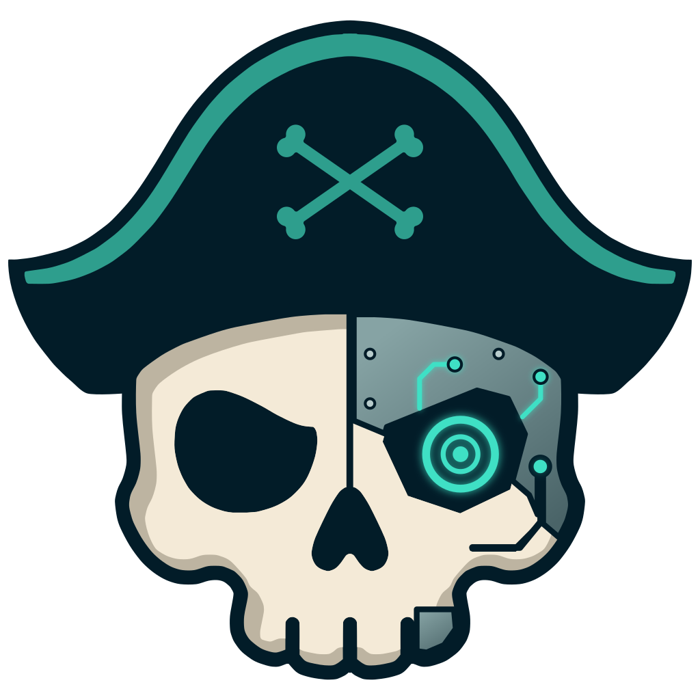
</p>

<p align="center">
  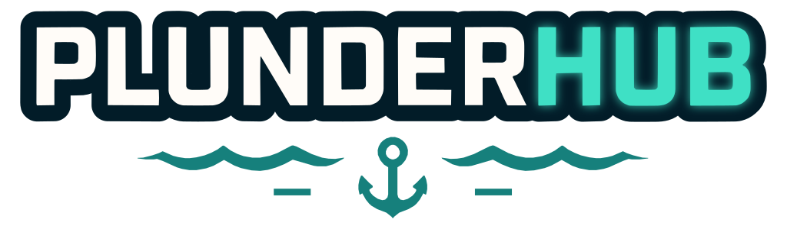
</p>

<p align="center">
  <strong>One ship for all your plunder.</strong><br>
  A Linux game launcher for your Steam, Heroic, Lutris, Bottles and Faugus games.
</p>

<p align="center">
  <a href="https://github.com/IkrajaDev/PlunderHub/releases/latest"></a>
  
  
  
</p>

<p align="center">
  <a href="#install"><b>Install</b></a> ·
  <a href="#screenshots"><b>Screenshots</b></a> ·
  <a href="#support"><b>Support</b></a>
</p>

<p align="center">
  
</p>

---

> [!NOTE]
> PlunderHub is in beta. Please report any bugs you find.

## Screenshots

<table>
  <tr>
    <td align="center" valign="top" width="50%">
      <a href="docs/gallery/01-library-grid.md">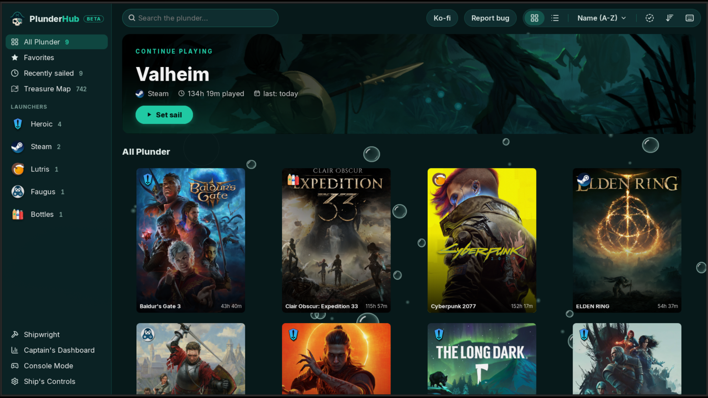</a><br>
      <sub>Library, grid view</sub>
    </td>
    <td align="center" valign="top" width="50%">
      <a href="docs/gallery/03-library-list.md">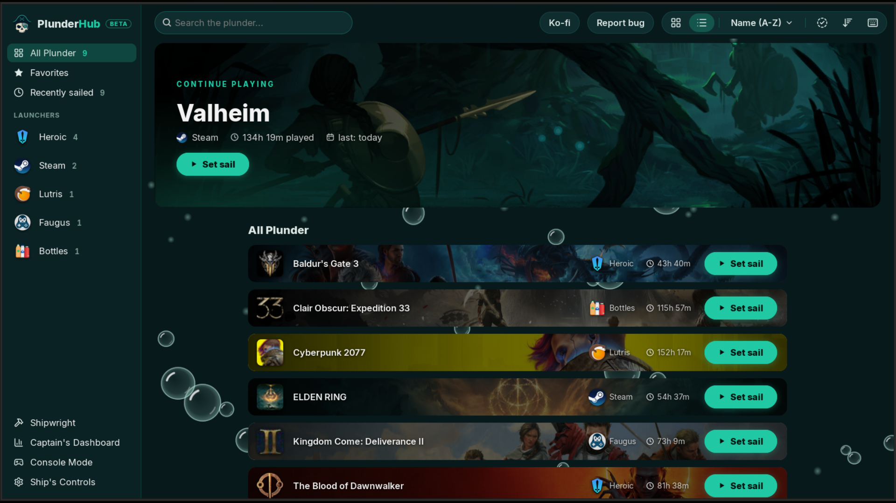</a><br>
      <sub>Library, list view</sub>
    </td>
  </tr>
  <tr>
    <td align="center" valign="top" width="50%">
      <a href="docs/gallery/05-console-mode.md">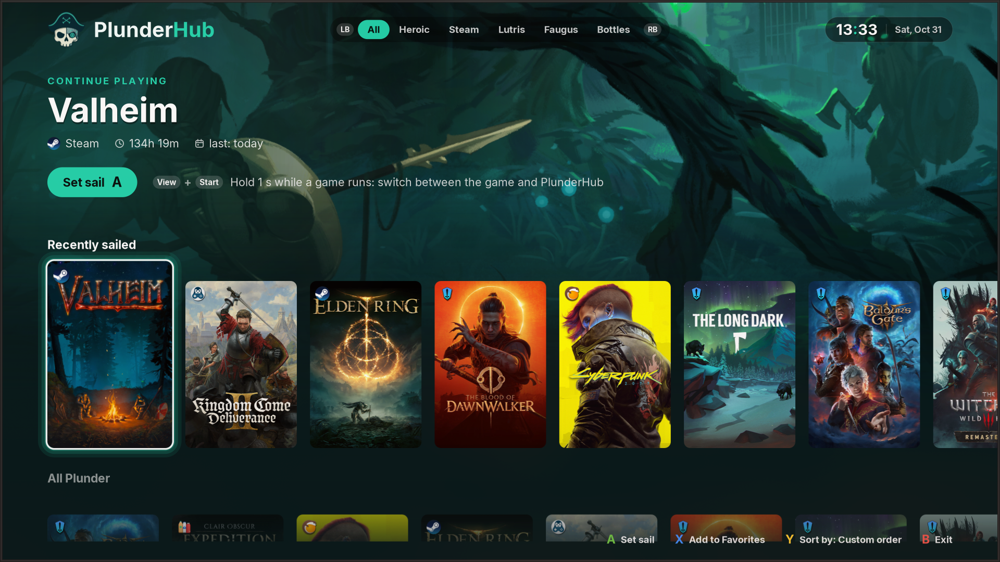</a><br>
      <sub>Console Mode</sub>
    </td>
    <td align="center" valign="top" width="50%">
      <a href="docs/gallery/04-edit-order.md">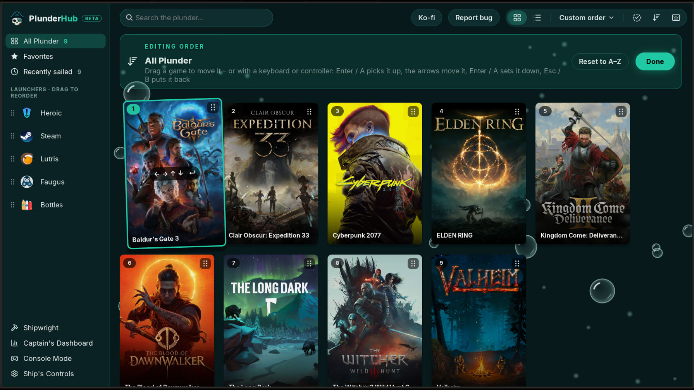</a><br>
      <sub>Edit order</sub>
    </td>
  </tr>
</table>

<details>
  <summary>More screenshots</summary>

<table>
  <tr>
    <td align="center" valign="top" width="50%">
      <a href="docs/gallery/02-game-menu.md">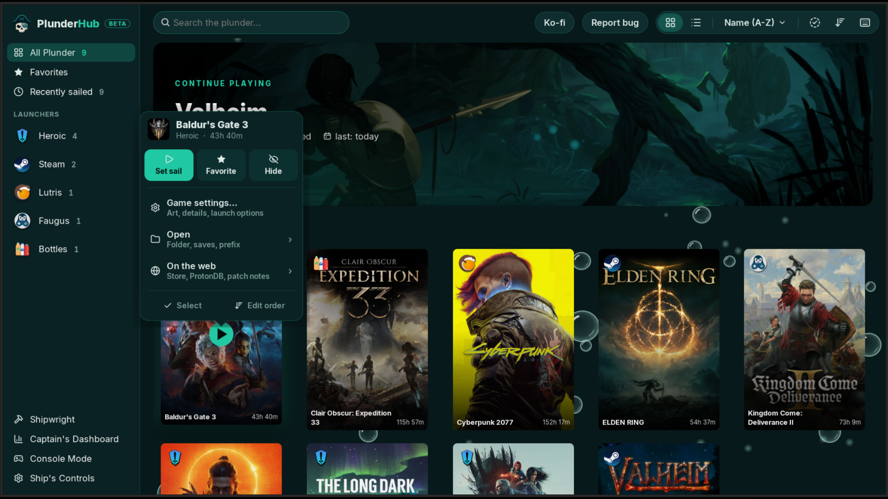</a><br>
      <sub>Game menu</sub>
    </td>
    <td align="center" valign="top" width="50%">
      <a href="docs/gallery/06-game-overview.md">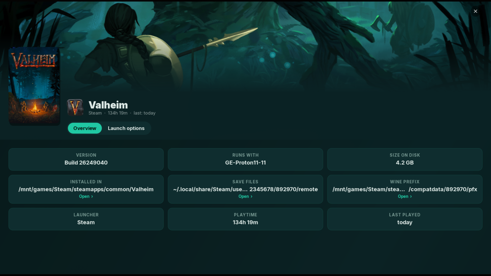</a><br>
      <sub>Game page</sub>
    </td>
  </tr>
  <tr>
    <td align="center" valign="top" width="50%">
      <a href="docs/gallery/07-game-launch-options.md">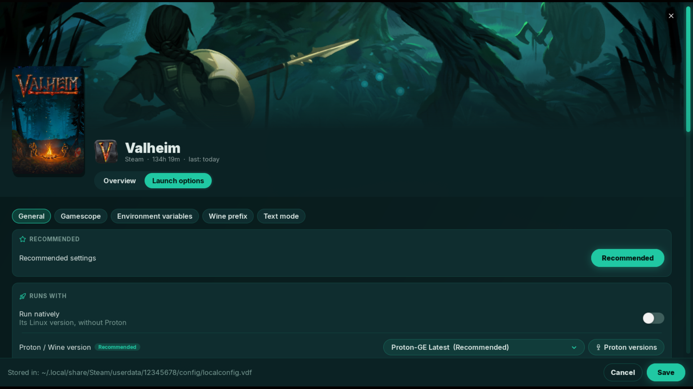</a><br>
      <sub>Launch options</sub>
    </td>
    <td align="center" valign="top" width="50%">
      <a href="docs/gallery/08-shipwright.md">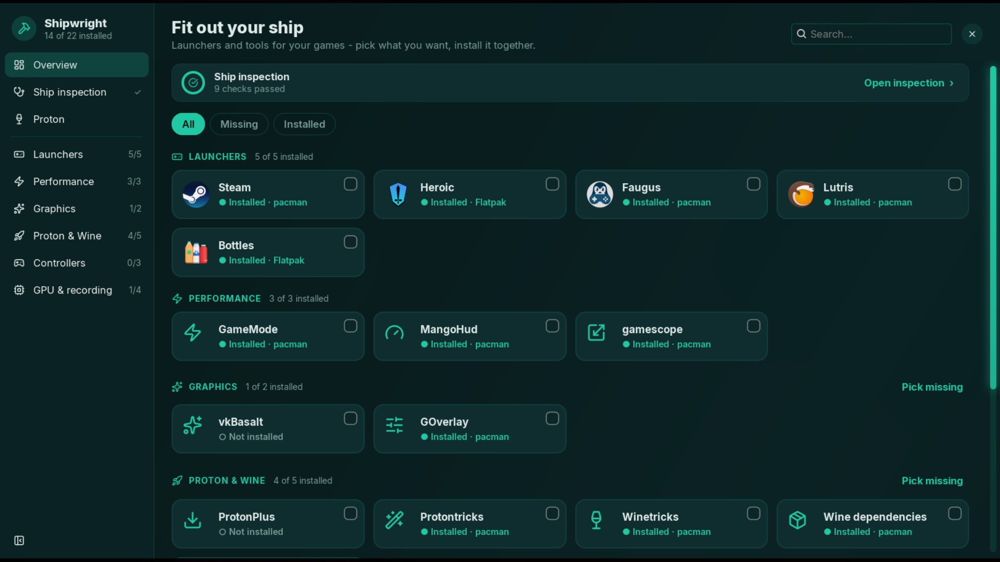</a><br>
      <sub>Shipwright</sub>
    </td>
  </tr>
  <tr>
    <td align="center" valign="top" width="50%">
      <a href="docs/gallery/09-captains-dashboard.md">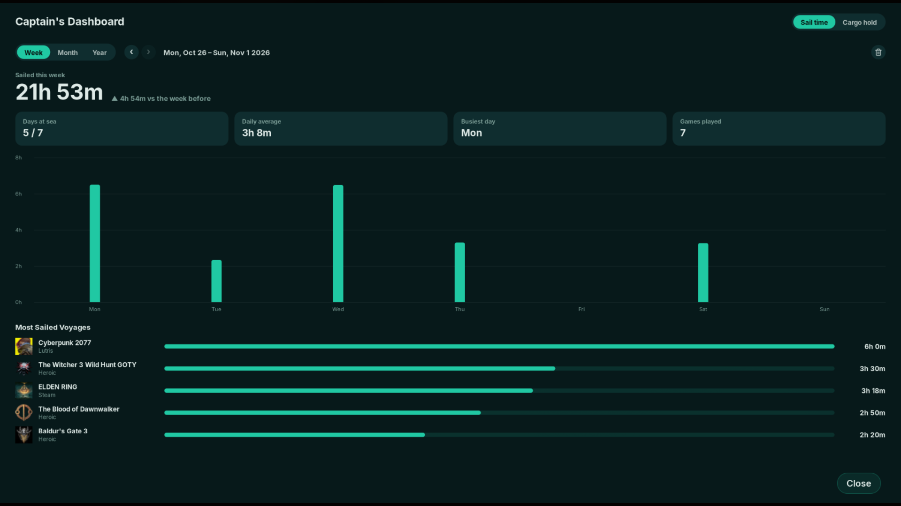</a><br>
      <sub>Captain's Dashboard</sub>
    </td>
    <td align="center" valign="top" width="50%">
      <a href="docs/gallery/10-settings-appearance.md">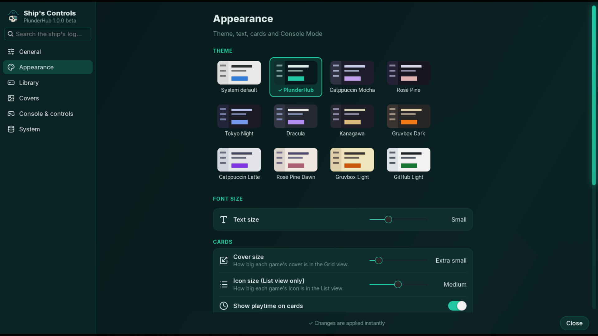</a><br>
      <sub>Ship's Controls</sub>
    </td>
  </tr>
</table>

</details>

## Features

<table>
  <tr>
    <td align="center" valign="top" width="33%">
      <br>
      <b>One library</b><br>
      <sub>Every launcher in one place</sub>
    </td>
    <td align="center" valign="top" width="33%">
      <br>
      <b>Live status</b><br>
      <sub>See what's running, stop it anytime</sub>
    </td>
    <td align="center" valign="top" width="33%">
      <br>
      <b>Launch options</b><br>
      <sub>Proton, gamescope, MangoHud per game</sub>
    </td>
  </tr>
  <tr>
    <td align="center" valign="top" width="33%">
      <br>
      <b>Console Mode</b><br>
      <sub>Made for controllers</sub>
    </td>
    <td align="center" valign="top" width="33%">
      <br>
      <b>Cover art</b><br>
      <sub>From your launchers or SteamGridDB, even animated</sub>
    </td>
    <td align="center" valign="top" width="33%">
      <br>
      <b>Themes</b><br>
      <sub>11 themes, or your desktop's own</sub>
    </td>
  </tr>
  <tr>
    <td align="center" valign="top" width="33%">
      <br>
      <b>Shipwright</b><br>
      <sub>Install launchers, tools and Proton</sub>
    </td>
    <td align="center" valign="top" width="33%">
      <br>
      <b>Playtime</b><br>
      <sub>Every session tracked</sub>
    </td>
    <td align="center" valign="top" width="33%">
      <br>
      <b>Dashboard</b><br>
      <sub>Playtime and storage at a glance</sub>
    </td>
  </tr>
  <tr>
    <td align="center" valign="top" width="33%">
      <br>
      <b>Saves</b><br>
      <sub>Heroic cloud sync, backup and restore</sub>
    </td>
    <td align="center" valign="top" width="33%">
      <br>
      <b>Ship inspection</b><br>
      <sub>Finds missing drivers and libraries, fixes them</sub>
    </td>
    <td align="center" valign="top" width="33%">
      <br>
      <b>Lightweight</b><br>
      <sub>Idles when you're not using it</sub>
    </td>
  </tr>
</table>

<details>
  <summary>More</summary>

- **Proton**: Proton-GE and Proton-CachyOS, downloaded once and used by every launcher, native or Flatpak. Proton-GE Latest updates itself.
- **Ship inspection**: checks Vulkan drivers (AMD, NVIDIA, Intel, hybrid laptops), 32-bit libraries, the memory map limit, ntsync and fonts. Fixes them in one click.
- **Shipwright**: installs launchers (native or Flathub) and tools like GameMode, MangoHud, gamescope and controller drivers.
- **Bilge cleaning**: finds what launchers left behind after a game was removed: Wine prefixes, shader caches and unused Proton versions, with their size. You pick what goes, to the Trash or for good. Backs up the saves in them first and puts them back later, even when the game is installed again somewhere else; a restore can be undone (beta).
- **Game page**: store, ProtonDB and patch notes links, and the game's ProtonDB rating for every launcher. Launch options with a Recommended preset. winecfg, winetricks and running an .exe in the game's prefix.
- **Art**: covers, banners and icons from your launchers. Add a free SteamGridDB key for more.
- **Steam Deck and Big Picture**: adds PlunderHub to Steam as a non-Steam game, with its own art (Settings > Library). Started from Big Picture or Game Mode it opens in Console Mode; from the desktop it asks.
- **Controllers**: Xbox, PlayStation, Switch Pro, 8BitDo and more, with matching button icons. Hold View + Start to switch between a game and PlunderHub.
- **Backup**: settings, playtime and art in one file.
- **Tray**: close to the tray, start hidden at login.
- **Updates**: tells you about new versions and can install them.

</details>

<p align="center"><sub>9 languages, mostly AI-translated. <a href="#about">Corrections welcome</a>.</sub></p>

## Install

Download:
```bash
git clone https://github.com/IkrajaDev/PlunderHub.git
cd PlunderHub
```

<sub>No <code>git</code>? Install it first - <code>sudo apt install git</code></sub>

Arch Linux:
```bash
makepkg -si
```

Other distros:
```bash
./install.sh
```

<sub>Or run it without installing: <code>python3 plunderhub.py</code></sub>

<sub>The installers set up all dependencies. <code>install.sh</code> supports Arch, Debian, Ubuntu, Fedora, openSUSE, Alpine, Void and distros based on them.</sub>

<details>
  <summary>Requirements</summary>

- Python 3.10+
- GTK 3 with PyGObject and pycairo
- PyYAML
- libsecret (stores the SteamGridDB key)
- WebP and SVG loaders for GTK, libwebp
- An AppIndicator library (tray icon)

</details>

## Updating

PlunderHub checks for updates at startup. **Auto** installs the update and restarts the app.

By hand:

Get the update:
```bash
cd PlunderHub
git pull
```

Arch Linux:
```bash
makepkg -si
```

Other distros:
```bash
./install.sh
```

<sub>Running from the folder? Just <code>git pull</code>.</sub>

## Getting started

1. Start PlunderHub. It finds your games.
2. Optional: for more art, add a free [SteamGridDB](https://www.steamgriddb.com) API key in **Ship's Controls → Covers**.
3. Open **Shipwright** to check your system and install launchers and tools.

## Uninstall

If you added PlunderHub to Steam, remove it first in Settings > Library.

Arch Linux:
```bash
sudo pacman -R plunderhub
```

Other distros (in the PlunderHub folder):
```bash
./uninstall.sh
```

<sub>Your settings stay in <code>~/.config/plunderhub</code>. Delete it for a clean start.</sub>

<sub>Proton versions PlunderHub downloaded stay in <code>~/.local/share/plunderhub</code> - your launchers can keep using them. Delete it if you don't need them.</sub>

## Known limitations

- **GNOME on Wayland** doesn't let apps move windows, so games open on the current workspace there.
- **Plain GNOME** has no tray. Closing the window quits PlunderHub. Ubuntu's GNOME and the [AppIndicator extension](https://extensions.gnome.org/extension/615/appindicator-support/) add one.
- **Add to Steam** needs Steam closed for a moment, so PlunderHub restarts it. A Flatpak Steam asks for a permission to start PlunderHub. The Snap Steam can't start other programs.
- **Read-only systems** (Bazzite, Silverblue): Shipwright installs launchers and tools as Flatpaks. System packages come through your system's own tools.

## Privacy

PlunderHub collects no data. It only connects to:

- Steam and your launchers' image servers, for art
- Steam's store, with a game's title, when you open its patch notes, and with a Steam ID when Bilge cleaning finds a left folder of a game PlunderHub never saw
- SteamGridDB, only with your key
- ProtonDB, with a game's Steam ID, for its rating on the game page (a game not from Steam is first looked up by its title in Steam's store search; you can turn this off in Settings)
- GitHub, for updates and Proton downloads
- Your distro's repositories, the AUR, Flathub, Launchpad (Ubuntu PPAs) or RPM Fusion (Fedora), when you install something

Settings are stored in <code>~/.config/plunderhub</code>. The SteamGridDB key goes to your system's password manager when there is one.

## Reporting bugs

<p align="center">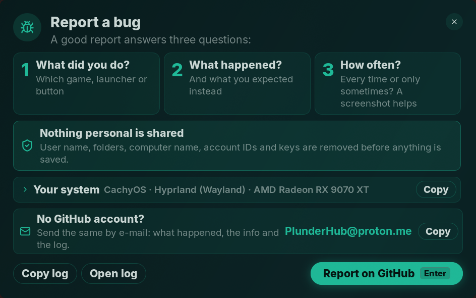</p>

1. Open **Report bug** in PlunderHub.
2. **Report on GitHub** opens the [bug form](https://github.com/IkrajaDev/PlunderHub/issues/new?template=bug_report.yml) with your system filled in.
3. **Copy log** and paste it into the form.

Nothing personal is included.<br>
No GitHub account? E-mail **PlunderHub@proton.me**

## Support

Enjoying PlunderHub? Buy the crew a round.

[](https://ko-fi.com/ikraja)

## About

**Translations** live in <code>locale/*.po</code> (gettext, works with Poedit or Weblate). Send fixes as an issue or pull request.

**AI disclosure**: PlunderHub is developed with help from AI (Claude). I review and test every change before release.

**License**: [GPL-3.0-or-later](LICENSE). Feature icons: [Lucide](https://lucide.dev) ([ISC](docs/icons/LUCIDE_LICENSE.txt)). Font: [Inter](https://rsms.me/inter/) ([SIL OFL 1.1](plunderhub/assets/fonts/INTER_LICENSE.txt)).

**Security**: found a security problem? Please don't open a public issue - see [SECURITY.md](SECURITY.md).

<sub>Launcher logos belong to their projects and are only used to name them ([sources](plunderhub/assets/launchers/LAUNCHER_ICONS_SOURCES.txt)).
Steam and the Steam logo are trademarks and/or registered trademarks of Valve Corporation in the U.S. and/or other countries. PlunderHub is not affiliated with or endorsed by Valve, or by any of the launchers it works with.</sub>
