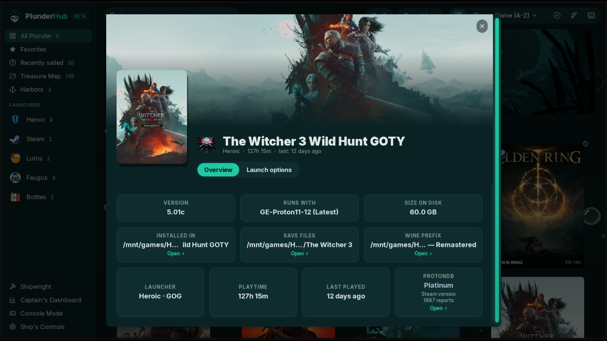

<h2 align="center">Game page</h2>

  <a href="02-treasure-map-card.md"><b>← Previous</b></a>
  &nbsp;·&nbsp; 3 / 18 &nbsp;·&nbsp;
  <a href="04-console-mode.md"><b>Next →</b></a>

  

  <a href="../../README.md#screenshots">Back to README</a>

