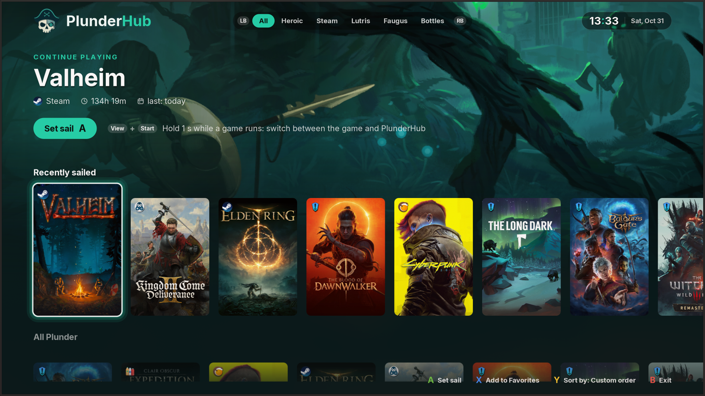

<h2 align="center">Console Mode</h2>

  <a href="04-edit-order.md"><b>← Previous</b></a>
  &nbsp;·&nbsp; 5 / 10 &nbsp;·&nbsp;
  <a href="06-game-overview.md"><b>Next →</b></a>

  

  <a href="../../README.md#screenshots">Back to README</a>

