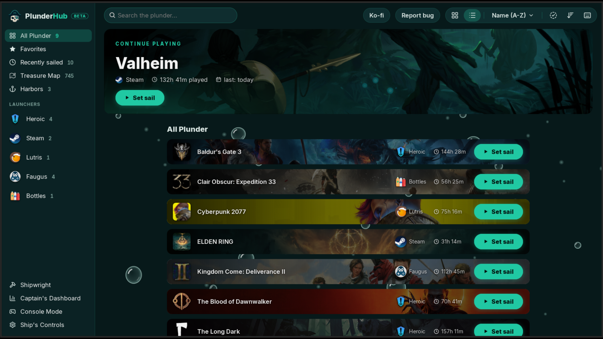

<h2 align="center">Library, list view</h2>

  <a href="04-console-mode.md"><b>← Previous</b></a>
  &nbsp;·&nbsp; 5 / 18 &nbsp;·&nbsp;
  <a href="06-edit-order.md"><b>Next →</b></a>

  

  <a href="../../README.md#screenshots">Back to README</a>

