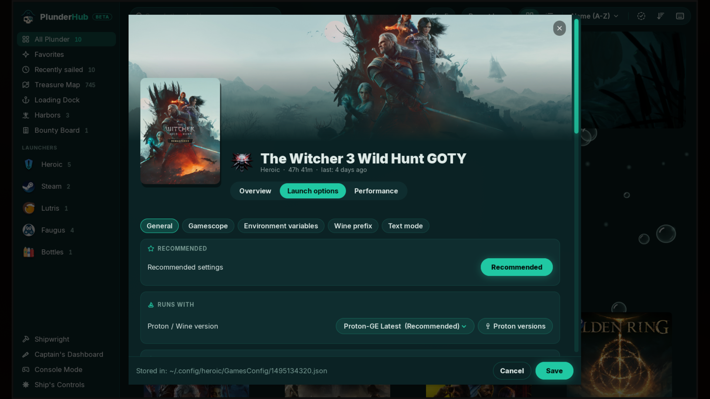

<h2 align="center">Launch options</h2>

  <a href="21-loading-dock.md"><b>← Previous</b></a>
  &nbsp;·&nbsp; 10 / 21 &nbsp;·&nbsp;
  <a href="22-dlc-tab.md"><b>Next →</b></a>

  

  <a href="../../README.md#screenshots">Back to README</a>

