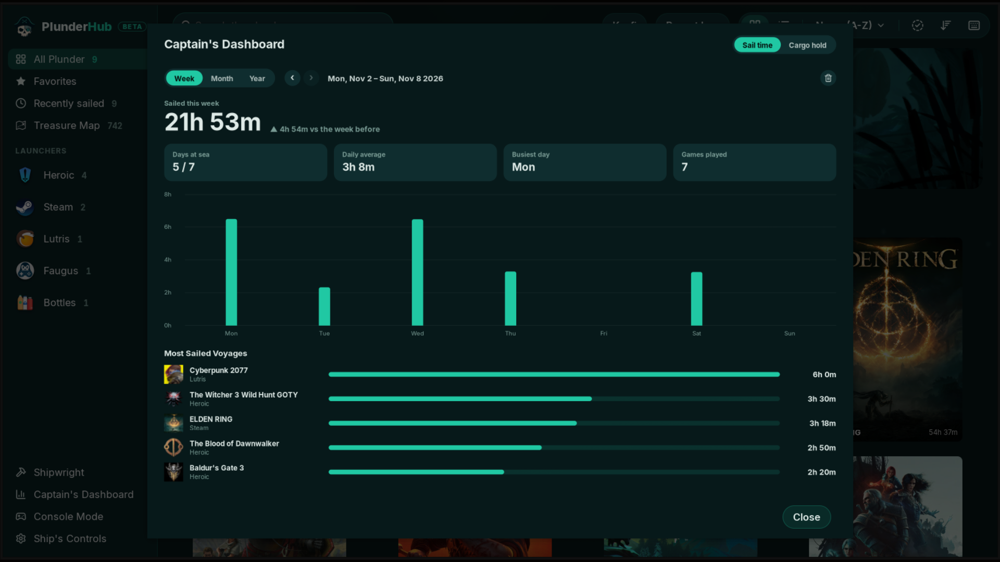

<h2 align="center">Captain's Dashboard</h2>

  <a href="12-bilge-cleaning.md"><b>← Previous</b></a>
  &nbsp;·&nbsp; 13 / 17 &nbsp;·&nbsp;
  <a href="14-cargo-hold.md"><b>Next →</b></a>

  

  <a href="../../README.md#screenshots">Back to README</a>

