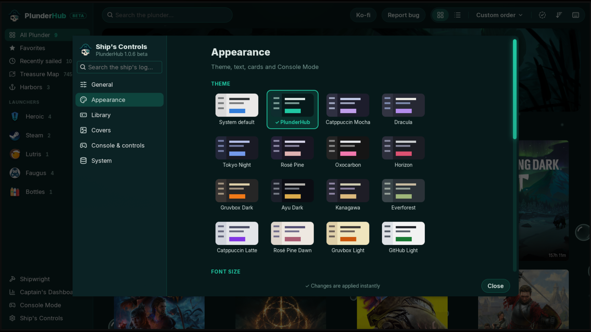

<h2 align="center">Ship's Controls</h2>

  <a href="15-cargo-hold.md"><b>← Previous</b></a>
  &nbsp;·&nbsp; 16 / 18 &nbsp;·&nbsp;
  <a href="17-themes.md"><b>Next →</b></a>

  

  <a href="../../README.md#screenshots">Back to README</a>

