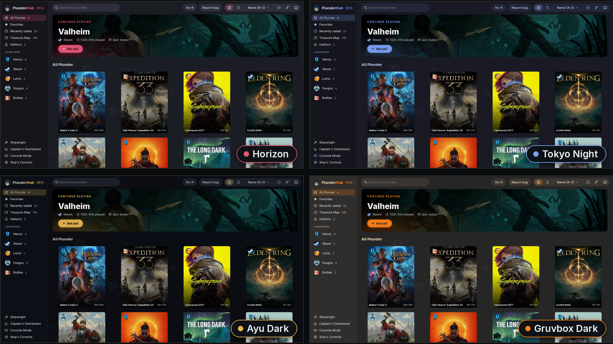

<h2 align="center">15 themes</h2>

  <a href="16-settings-appearance.md"><b>← Previous</b></a>
  &nbsp;·&nbsp; 17 / 18 &nbsp;·&nbsp;
  <a href="18-report-bug.md"><b>Next →</b></a>

  

  <a href="../../README.md#screenshots">Back to README</a>

