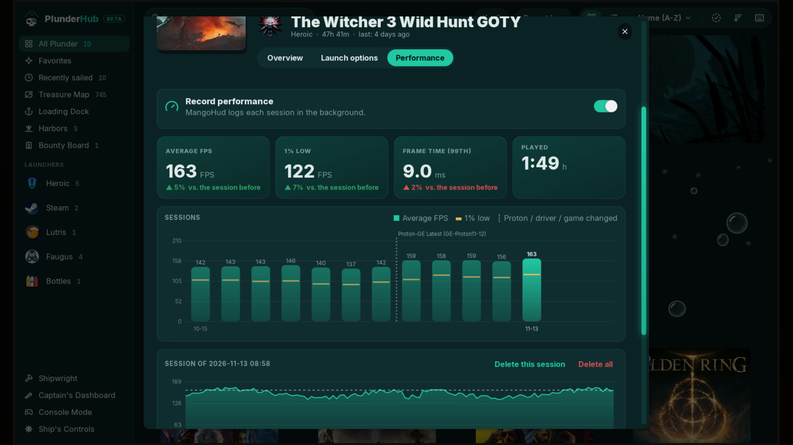

<h2 align="center">Performance, session by session</h2>

  <a href="19-bounty-board.md"><b>← Previous</b></a>
  &nbsp;·&nbsp; 13 / 21 &nbsp;·&nbsp;
  <a href="11-proton-versions.md"><b>Next →</b></a>

  

  <a href="../../README.md#screenshots">Back to README</a>

